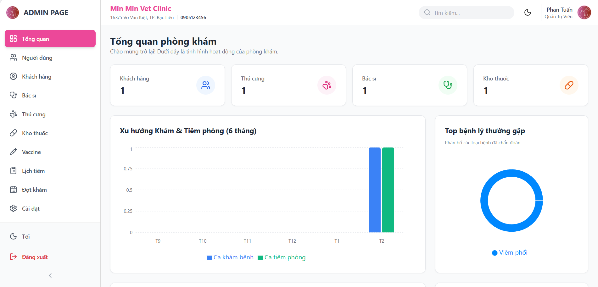
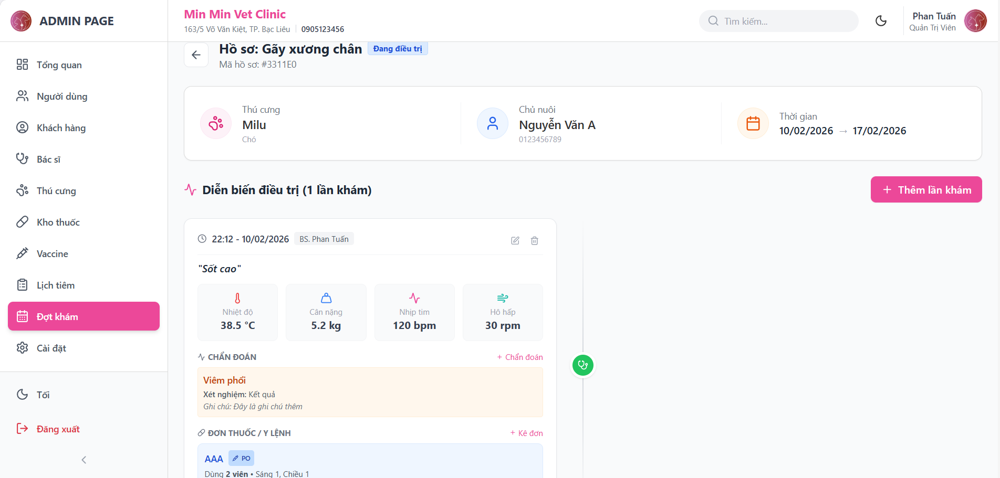

<div align="center">

  <h1>Vet Clinic Management System</h1>
  <h3>Hệ thống Quản lý Phòng khám Thú y Toàn diện</h3>

  <p>
    Một giải pháp phần mềm hiện đại giúp số hóa quy trình vận hành phòng khám thú y. 
    Hệ thống bao gồm quản lý hồ sơ bệnh án điện tử, theo dõi điều trị nội trú, quản lý kho dược và báo cáo doanh thu thông minh.
  </p>

  <p>
    
    
    
    
    
    
    
  </p>

</div>

<br />

# FRONTEND ADMIN DASHBOARD

Đây là kho lưu trữ chứa mã nguồn **Frontend**, cung cấp giao diện quản trị trực quan, hiện đại dành cho Bác sĩ và Nhân viên vận hành hệ thống Vet Clinic.

---

## Mục lục

- [1. Công nghệ & Thư viện Cốt lõi](#1-công-nghệ--thư-viện-cốt-lõi)
  - [Khung Giao diện & Nền tảng Ứng dụng](#khung-giao-diện--nền-tảng-ứng-dụng)
  - [Thiết kế Giao diện & Định dạng](#thiết-kế-giao-diện--định-dạng)
  - [Giao tiếp Mạng & Xử lý Trạng thái](#giao-tiếp-mạng--xử-lý-trạng-thái)
  - [Trực quan hóa Dữ liệu & Trải nghiệm Người dùng](#trực-quan-hóa-dữ-liệu--trải-nghiệm-người-dùng)
- [2. Tính năng Giao diện & Trải nghiệm Người dùng](#2-tính-năng-giao-diện--trải-nghiệm-người-dùng)
- [3. Demo Giao diện](#3-demo-giao-diện)
- [4. Hướng dẫn Cài đặt & Khởi chạy](#4-hướng-dẫn-cài-đặt--khởi-chạy)
- [5. Cấu trúc Thư mục Dự án](#5-cấu-trúc-thư-mục-dự-án)
- [6. Kết nối Backend API Service](#6-kết-nối-backend-api-service)
- [7. Tác giả](#7-tác-giả)

---

## 1. Công nghệ & Thư viện Cốt lõi

Hệ thống Frontend được phát triển trên nền tảng công nghệ hiện đại trong hệ sinh thái React và Next.js:

### Khung Giao diện & Nền tảng Ứng dụng

| Công nghệ / Thư viện | Phiên bản | Vai trò Kỹ thuật |
| :--- | :--- | :--- |
| **[Next.js](https://nextjs.org/)** | `16.4.3` | Khung ứng dụng React App Router, Server Components và trình biên dịch Turbopack tối ưu hiệu năng |
| **[React](https://react.dev/)** | `19.3.1` | Thư viện UI cốt lõi phiên bản React 19, xây dựng giao diện Component-based |
| **[react-dom](https://react.dev/learn/rendering-elements)** | `19.3.1` | Thư viện kết xuất DOM cho React 19 |
| **[TypeScript](https://www.typescriptlang.org/)** | `^5.9.3` | Đảm bảo tính an toàn kiểu dữ liệu tĩnh (Type Safety) trên toàn bộ dự án |

---

### Thiết kế Giao diện & Định dạng

| Công nghệ / Thư viện | Phiên bản | Vai trò Kỹ thuật |
| :--- | :--- | :--- |
| **[Tailwind CSS](https://tailwindcss.com/)** | `^3.4.1` | Framework CSS Utility-first giúp xây dựng giao diện linh hoạt, chuẩn hóa thiết kế |
| **[Tailwind Merge](https://tailwind-merge.vercel.app/)** | `^3.7.0` | Hợp nhất class Tailwind thông minh, giải quyết xung đột thuộc tính |
| **[clsx](https://github.com/lukeed/clsx)** | `^2.1.1` | Tiện ích hỗ trợ ghép nối class CSS theo điều kiện logic |
| **[Lucide React](https://lucide.dev/)** | `^1.61.0` | Bộ biểu tượng SVG sắc nét, tối giản và đồng bộ cho giao diện người dùng |
| **[next-themes](https://github.com/pacocoursey/next-themes)** | `^0.4.6` | Quản lý chuyển đổi chế độ Sáng / Tối (Dark & Light Mode) mượt mà |

---

### Giao tiếp Mạng & Xử lý Trạng thái

| Công nghệ / Thư viện | Phiên bản | Vai trò Kỹ thuật |
| :--- | :--- | :--- |
| **[Axios](https://axios-http.com/)** | `^1.20.0` | Tầng giao tiếp HTTP Client gọi API Backend, hỗ trợ Interceptors tự động đính kèm Token xác thực |
| **[js-cookie](https://github.com/js-cookie/js-cookie)** | `^3.0.8` | Điều phối lưu trữ và truy xuất Cookie an toàn phía trình duyệt |

---

### Trực quan hóa Dữ liệu & Trải nghiệm Người dùng

| Công nghệ / Thư viện | Phiên bản | Vai trò Kỹ thuật |
| :--- | :--- | :--- |
| **[Recharts](https://recharts.org/)** | `^3.10.1` | Trực quan hóa dữ liệu thống kê: biểu đồ cột xu hướng khám bệnh và biểu đồ tròn tỷ lệ bệnh lý |
| **[Sonner](https://sonner.emilkowal.ski/)** | `^2.0.8` | Thư viện hiển thị thông báo Toast Notification hiện đại, mượt mà |
| **[date-fns](https://date-fns.org/)** | `^4.4.0` | Thư viện xử lý và định dạng ngày giờ chuẩn hóa |
| **[react-to-print](https://github.com/gregnb/react-to-print)** | `^3.3.0` | Hỗ trợ in ấn trực tiếp hồ sơ bệnh án, đơn thuốc và phiếu chỉ định |

---

## 2. Tính năng Giao diện & Trải nghiệm Người dùng

* **Bảng Điều Khiển Thông Minh (Smart Dashboard):**
  * Biểu đồ xu hướng khám chữa bệnh (Bar Chart) trực quan, giúp theo dõi tần suất bệnh nhân theo từng tháng.
  * Biểu đồ tỷ lệ bệnh lý (Pie Chart) phản ánh cơ cấu các nhóm bệnh phổ biến cần ưu tiên điều trị.
  * Danh sách ca điều trị nội trú cập nhật thời gian thực, hỗ trợ bác sĩ theo dõi tiến độ bệnh án.
* **Quản Lý Bệnh Án Điện Tử:**
  * Dòng thời gian (Timeline) hiển thị tiến trình khám chữa bệnh tuần tự, dễ quan sát và truy xuất tiền sử điều trị.
  * Biểu mẫu nhập liệu thông minh cho các chỉ số sinh tồn (thân nhiệt, cân nặng, nhịp thở), chẩn đoán và đơn thuốc.
  * Tự động tính toán liều lượng dược phẩm theo cân nặng của thú cưng, giảm thiểu tối đa sai sót y khoa.
* **Tối Ưu Trải Nghiệm Người Dùng:**
  * Giao diện tương thích hoàn hảo (Responsive) trên màn hình máy tính bàn, máy tính bảng và thiết bị di động.
  * Chuyển đổi linh hoạt giữa giao diện Sáng (Light Mode) và Tối (Dark Mode) theo sở thích người dùng.
* **Trang Giới Thiệu Dịch Vụ (Landing Page):**
  * Giới thiệu các gói chăm sóc, danh mục bác sĩ chuyên môn và thông tin liên hệ phòng khám một cách trực quan.

---

## 3. Demo Giao diện

### Bảng Điều Khiển Quản Trị (Admin Dashboard)


### Quản Lý Bệnh Án Điện Tử (Electronic Medical Records)


---

## 4. Hướng dẫn Cài đặt & Khởi chạy

### Yêu cầu Hệ thống
* **Node.js:** Phiên bản `>= 20.0.0` (Khuyến nghị **Node.js 20.x** hoặc **22.x LTS**).
* **Trình quản lý gói:** `npm` (>= 9), `yarn`, `pnpm` hoặc `bun`.
* **Backend Service:** Máy chủ **Vet Clinic Backend API** đang hoạt động tại cổng `3001`.

### Quy trình Cài đặt

```bash
# 1. Tải mã nguồn Frontend về máy cục bộ
git clone https://github.com/hvt299/Vet-Clinic-Web.git
cd Vet-Clinic-Web

# 2. Cài đặt toàn bộ thư viện phụ thuộc
npm install
```

### Cấu hình Biến Môi trường (.env)

Tạo tệp `.env` tại thư mục gốc của dự án:

```env
# Địa chỉ máy chủ Backend API
NEXT_PUBLIC_API_URL=http://localhost:3001
```

### Các Lệnh Thực thi

```bash
# 1. Khởi chạy máy chủ phát triển (Turbopack)
npm run dev

# 2. Biên dịch bản phát hành sản phẩm (Production Build)
npm run build

# 3. Khởi chạy bản production đã biên dịch
npm run start

# 4. Kiểm tra lỗi cú pháp và tiêu chuẩn mã nguồn (ESLint)
npm run lint
```

Sau khi khởi chạy thành công, truy cập ứng dụng trên trình duyệt tại địa chỉ:
```text
http://localhost:3000
```

---

## 5. Cấu trúc Thư mục Dự án

```text
Vet-Clinic-Web/
├── app/                           # Cấu trúc Next.js App Router (Pages, Layouts & Routes)
│   ├── (auth)/login/              # Trang đăng nhập xác thực
│   ├── customers/                 # Quản lý hồ sơ khách hàng
│   ├── dashboard/                 # Bảng điều khiển số liệu tổng quan
│   ├── doctors/                   # Quản lý danh bạ bác sĩ thú y
│   ├── medicines/                 # Quản lý kho dược phẩm
│   ├── pets/                      # Quản lý hồ sơ thú cưng
│   ├── profile/                   # Thông tin tài khoản người dùng
│   ├── settings/                  # Cấu hình cài đặt hệ thống
│   ├── treatments/                # Quản lý đợt điều trị và bệnh án
│   │   └── [id]/                  # Chi tiết đợt điều trị và các buổi khám
│   ├── users/                     # Quản trị tài khoản nhân sự
│   ├── vaccinations/              # Quản lý lịch tiêm phòng thú cưng
│   ├── vaccines/                  # Quản lý danh mục vắc-xin
│   ├── globals.css                # Thiết lập bảng màu và CSS biến toàn cục
│   └── layout.tsx                 # Root Layout cấu hình ThemeProvider và Font
├── components/                    # Các thành phần giao diện tái sử dụng
│   ├── admin/                     # Sidebar, Header và thanh điều hướng quản trị
│   └── ui/                        # Các khối giao diện nguyên tử (Buttons, Inputs, Modals)
├── lib/                           # Các tiện ích bổ trợ và bộ lọc dữ liệu
├── services/                      # Tầng giao tiếp HTTP API với Backend (Axios Client)
├── public/                        # Thư mục tài nguyên tệp tĩnh và ảnh minh họa
│   └── demo/                      # Tệp hình ảnh chụp màn hình demo giao diện
├── package.json                   # Danh mục thư viện phụ thuộc và cấu hình phiên bản
└── tsconfig.json                  # Cấu hình kiểm tra kiểu dữ liệu TypeScript
```

---

## 6. Kết nối Backend API Service

Ứng dụng Frontend được thiết kế để kết nối trực tiếp với **Vet Clinic Backend Service** (chạy tại cổng mặc định `3001`):
* Giao diện quản trị gửi các truy vấn RESTful API để đồng bộ dữ liệu hồ sơ bệnh án, lịch tiêm phòng và chỉ số thống kê.
* Đảm bảo cập nhật chính xác địa chỉ API trong tệp cấu hình: `NEXT_PUBLIC_API_URL=http://localhost:3001`.

---

## 7. Tác giả

Được phát triển bởi **Mr.T (hvt299)**  
GitHub: [https://github.com/hvt299](https://github.com/hvt299)
